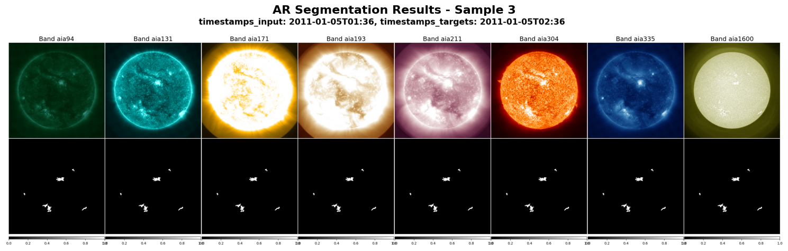

# Active Region Segmentation

A fine-tuning example for solar Active Region (AR) segmentation using the Surya foundation model. This project demonstrates how to adapt Surya for downstream computer vision tasks on solar imagery.


## Requirements

### System Requirements
- Python 3.8+
- CUDA-capable GPU (recommended)
- 50GB+ free disk space for dataset
- Hugging Face account for data access


## Setup and Data Download

```bash
cd downstream_examples/ar_segmentation

# Download AR segmentation dataset (requires Hugging Face login)
bash download_data.sh

# Create CSV indices for training data
python create_ar_csv.py

# unzip masks stored in data.tar.gz in data
cd assets/surya-bench-ar-segmentation
mkdir -p data
tar -xvzf data.tar.gz -C data
```

## Training

```bash
cd downstream_examples/ar_segmentation
# Single GPU training
torchrun --nnodes=1 --nproc_per_node=1 --standalone finetune.py

# Multi-GPU training (example for 4 GPUs)
torchrun --nnodes=1 --nproc_per_node=4 --standalone finetune.py
```

## Inference

Run Active Region segmentation inference using either the interactive notebook or command-line scripts.
**Prerequisites**: Download all the data using the [download_data.sh](download_data.sh) script.

### Option A: Interactive Notebook (Recommended for beginners)

The [ar_segmentation_tutorial.ipynb](ar_segmentation_tutorial.ipynb) notebook provides step-by-step guidance with visualizations.

### Option B: Command-Line Inference

**Basic GPU Inference**
```bash
python infer.py --checkpoint_path ./assets/ar_segmentation_weights.pth \
                --output_dir ./inference_results \
                --num_samples 3 \
                --device cuda 
```

**CPU Inference** (slower but no GPU required)
```bash
python infer.py --checkpoint_path ./assets/ar_segmentation_weights.pth \
                --output_dir ./inference_results \
                --num_samples 3 \
                --device cpu
```

**Advanced Usage**
```bash
# Custom configuration and more samples
python infer.py --config_path ./config.yaml \
                --checkpoint_path ./assets/ar_segmentation_weights.pth \
                --output_dir ./custom_results \
                --num_samples 10 \
                --data_type valid \
                --device cuda
```

### Parameters Reference
| Parameter | Default | Description |
|-----------|---------|-------------|
| `--config_path` | `./config.yaml` | Path to model configuration file |
| `--checkpoint_path` | `./assets/ar_segmentation_weights.pth` | Path to trained model weights |
| `--output_dir` | `./inference_results` | Directory for saving results |
| `--num_samples` | `3` | Number of samples to process and visualize |
| `--data_type` | `test` | Dataset split to use (`test` or `valid`) |
| `--device` | `cuda` | Computing device (`cuda` or `cpu`) |

#### Output
- **Visualizations**: Multi-panel images showing input channels, predictions, and ground truth
- **Format**: High-resolution PNG files
- **Naming**: `test_0.png`, `test_1.png`, etc.
- **Location**: Specified `output_dir`


The output 
## Dataset Information

### Input Data
- **Format**: SDO/AIA multi-channel solar images
- **Shape**: (13, 4096, 4096) - 13 channels including:
  - AIA channels: 94Å, 131Å, 171Å, 193Å, 211Å, 304Å, 335Å, 1600Å
  - HMI channels: Magnetogram, Bx, By, Bz, Velocity
- **Temporal coverage**: 2011-2014
- **Cadence**: 12-minute intervals

### Output Data
- **Format**: Binary segmentation masks
- **Shape**: (4096, 4096)
- **Classes**: Background (0) and Active Region (1)

### Data Source
The dataset is hosted on Hugging Face: [nasa-ibm-ai4science/surya-bench-ar-segmentation](https://huggingface.co/datasets/nasa-ibm-ai4science/surya-bench-ar-segmentation)
For more details on mask creation methodology, see [SuryaBench AR Segmentation](https://github.com/NASA-IMPACT/SuryaBench/tree/main/ar_segmentation).

### Finetuning on a single day

`config_feb15_2013.yaml` trains on one day and validates on a different held-out day:

| | Date | Official split |
|---|---|---|
| train | 2013-02-15 | `train.csv` -- earliest 2013 date in the train split |
| validation | 2013-01-15 | `validation.csv` |

```bash
torchrun --nnodes=1 --nproc_per_node=1 --standalone finetune.py \
    --config_path ./config_feb15_2013.yaml
```

The shipped indices have no January 2013 rows in the train split, and no single-day
index exists for either date, so the config uses generated indices under
`assets/single_day/`. Regenerate them (or make indices for another day) with:

```bash
python make_day_index.py --date 2013-02-15
python make_day_index.py --date 2013-01-15
```

The script lists the S3 bucket for the requested day, pulls the matching mask rows out
of whichever shipped AR split contains that date, and reports how many samples survive
the dataset's validity filter -- use that number for `iters_per_epoch_*`.

Both days give **21 samples**. SDO has a daily gap at 21:00, leaving 23 of 24 hourly
masks, and the `+60 min` target requirement then drops 20:00 (its target is the missing
21:00) and 23:00 (its target falls on the next day). Each generated SDO index matches
the corresponding shipped index exactly -- 119 files for 2013-02-15 against the train
index, 116 for 2013-01-15 against the valid index.

The two days come from different official splits, so validation is genuinely held out --
but 21 samples from a single day covers one active-region configuration, so read the
metric as a smoke signal, not as real performance. Checkpoints go to
`checkpoints_feb15_2013/` so they do not overwrite a full run.

### Holdout AR catalogs

Uncertainty runs are evaluated on a handful of large, well-resolved ARs rather than on the
whole split. `make_holdout_catalog.py` builds those shortlists. Each AR is summarised at its
*peak* -- the hour its deprojected bounding box is largest -- and ranked by that area:

```bash
# 2020-2024, the 88 largest cleanly-deprojected ARs
python make_holdout_catalog.py --split test \
    --out assets/surya-bench-ar-segmentation/holdout_ar_large_from_test.csv

# every test-era HARP, unfiltered
python make_holdout_catalog.py --split test --top 0 --no-deproj-ok-only \
    --out assets/harp_catalog_test_full.csv

# 2010-2019, the 30 ARs that cost the least training data to hold out
python make_holdout_catalog.py --split train --holdout-select 30 \
    --out assets/surya-bench-ar-segmentation/holdout_ar_large_from_training.csv
```

Two inputs are needed, neither of which `download_data.sh` fetches:
`harp_catalog_subset.csv` (hourly HARP bounding boxes exported from JSOC `hmi.Mharp_720s`,
2010-05-13 to 2024-12-31) and `unified_catalog.csv` (every split concatenated, tagged by a
`source` column). Pass them with `--harp-catalog` / `--unified-catalog`; the defaults assume
both sit in `assets/`. The script does no network access -- the JSOC export is a prerequisite,
not something it performs.

Areas are deprojected with `R_sun = 696,000 km`, scaling the longitudinal extent by
`cos(mean latitude)` so an AR's true size is ranked rather than its foreshortened one. ARs
within 50 deg of a limb are still unreliable at that correction, so they are tagged
`deproj: Poor` and dropped unless `--no-deproj-ok-only` is passed. **`rank` is assigned over
every AR in the era before filtering**, which is why the filtered files have non-contiguous
ranks -- `holdout_ar_large_from_test.csv` starts at rank 2 because rank 1 (HARP 9475) is a
polar limb region.

`<split>_overlap_files` counts how many of that split's mask files the AR appears in, i.e. how
much data a run loses by holding it out. The 2020-2024 era needs no holdout *selection* --
training stops at 2019-12-31, so it is held out by construction. `--holdout-select` exists for
eras a model trains on: it keeps only ARs that touch no validation or leaky-validation frame
at all, then takes the N with the smallest training overlap.

The catalogs themselves are not in git -- `assets/` is a symlink to shared storage, and the
HARP export is far too large to vendor. The script does reproduce all three existing catalogs
byte-for-byte, so a regenerated file can be diffed against the copy already on disk as a
correctness check before overwriting it:

```bash
python make_holdout_catalog.py --split test --out /tmp/rebuilt.csv
diff assets/surya-bench-ar-segmentation/holdout_ar_large_from_test.csv /tmp/rebuilt.csv
```

### Non-flaring control set

The large-AR holdout is deliberately extreme -- the top three are 9-11 region complexes,
two of them EUV-flaring, with masks 3.9-4.3 % positive against 0.643 % for training-era
validation frames. Spread measured only there cannot separate "large" from "active". The
control set is mid-sized and quiescent, built in two steps:

```bash
# 1. the area band, no network
python make_holdout_catalog.py --split test --top 0 \
    --area-min 10000 --area-max 20000 --out /tmp/band.csv        # 216 ARs

# 2. flare-annotate and select (first run fetches HEK, ~12 min)
PYTHONPATH=../.. python annotate_flares.py --catalog /tmp/band.csv \
    --annotated-out assets/surya-bench-ar-segmentation/holdout_ar_nonflaring_band_annotated.csv \
    --select-nonflaring 30 --allow-below-class C1.0 --max-flares 1 \
    --out assets/surya-bench-ar-segmentation/holdout_ar_nonflaring_30_from_test.csv
```

`annotate_flares.py` appends `lifetime_start, lifetime_end, noaa_regions, n_flares,
max_goes_class, n_euv_events, flaring_at_peak` to the catalog's canonical 14 columns, so
anything reading the family schema by name is unaffected. Re-select under different criteria
with `--from-annotated`, which reuses the annotated CSV and touches the network not at all.

Two measures of activity are recorded because neither suffices alone. GOES-classified flares
are matched by NOAA region (`ar_noaanum % 10000` -- HEK truncates the leading 1 inconsistently,
returning both `3839` and `13839` for 2024-10-01). Flare Detective rows carry **no** NOAA
number and no GOES class at all, only `hgs_x`/`hgs_y`, so they are matched positionally against
the HARP's *hourly* bounding box; a fixed box would be wrong by most of a solar radius by the
end of a 13-day track as the AR rotates across the disk.

What the criteria above mean, and why they are not looser:

* **A NOAA region is required.** 85 of the 216 band ARs have none, and for those "non-flaring"
  is unverifiable rather than verified -- with no region number nothing *can* be attributed, so
  zero flares is trivially true and is not evidence of quiescence.
* **`--max-flares` is not optional in practice.** Filtering on peak class alone admitted an AR
  with 58 B-class flares and another flaring at its own peak timestamp. Class caps magnitude,
  not activity.
* **27 of the 30 have zero flares outright**; the other three have a single B-class microflare
  (B7.9, B8.5, B9.0), all below the conventional C1.0 floor. The zero-flare 27 are exactly the
  `n_flares == 0` subset, so the stricter set needs no separate file.

Only 6 of the 30 also have zero EUV detections -- these ARs are quiet in GOES terms, not inert.
Use `--require-euv-quiet` if that matters, but it will not yield 30 from this band.

### Boundary and calibration statistics over a whole holdout cohort

`view_harp11930_ensemble_mean_672hr.ipynb` measures boundary localization (its section 6) and
calibration (section 7) on **one** frame. `analyze_holdout_sections67.py` runs the identical
measurements over any number of frames, so those single-frame numbers can be read as
distributions. Three steps, in order:

```bash
# 1. stage the one input cube per AR the catalog names (30 cubes, 15.7 GB)
python download_holdout_nc.py --dry-run          # check the keys and the byte count first
python download_holdout_nc.py

# 2. every member's best checkpoint over every cube (300 inferences, ~70 min on a T4)
PYTHONPATH=../.. python run_bootstrap_inference.py --regime 672hr \
    --nc_dir /efs/bathomas/assets/holdout_nc_nonflaring30 \
    --output_root /efs/bathomas/ar_seg_bootstrap/672hr_infer_holdout_nonflaring30

# 3. sections 6 and 7 per frame, cached + four tidy CSVs (~45 s per frame, CPU only)
python analyze_holdout_sections67.py \
    --infer_root /efs/bathomas/ar_seg_bootstrap/672hr_infer_holdout_nonflaring30 \
    --frames_csv /efs/bathomas/assets/holdout_nc_nonflaring30/frames.csv
```

`view_holdout_nonflaring30_sections67_672hr.ipynb` then reads the cache and does the
cross-AR statistics: mean +/- between-frame sd of uncertainty / error / their ratio, the
per-member ranking with Kendall's *W*, a one-way random-effects split of the per-member ASSD
into between-frame and between-member variance, the exact pooled boundary-distance ECDF and
reliability curve, and three exemplar ARs.

`view_holdout_nonflaring30_sections67_672hr_stable.ipynb` is the same analysis for the
stabilized ensemble (`--regime 672hr_stable`, output root
`672hr_stable_infer_holdout_nonflaring30`), and additionally **pairs every quantity against the
`672hr` run AR by AR** -- the 30 ARs are identical in both, so each comparison is a Wilcoxon
signed-rank test on per-AR differences rather than two cohort means. The between-frame sd of
the error/uncertainty ratio is 1.31, far larger than any shift between training regimes, so the
pairing is what makes the comparison resolvable at all. §1 asserts the pairing is real by
checking that each AR's ground-truth positive fraction -- a property of the masks alone -- is
bit-identical between the two runs.

Disk: 15.7 GB of input cubes plus ~23 GB of inference output (`channels.nc` is 436 MB per
frame and is only needed for the exemplar figures). Both live on EFS.

Three things worth knowing before reading the output:

* **`--regime` selects the ensemble.** Everything above is parameterized the same way
  `run_bootstrap_inference.py` is, so the `168hrs` and `672hr_stable` cohorts are the same three
  commands with one flag changed. `2016hr` is not reachable until it has an entry in
  `BEST_EPOCH_BY_REGIME`. Note that `--regime` is a free-form string to
  `analyze_holdout_sections67.py` (it is only recorded in the cache attrs), but
  `run_bootstrap_inference.py` gates it on that table's keys.
* **The analysis script never imports torch.** Each member's epoch and validation IoU come
  from the `prob_*.nc` attributes, which record what actually ran; `--check-best-epoch`
  cross-checks them against `BEST_EPOCH_BY_REGIME` and is the only path that pulls in the
  model stack.
* **Section 6 needs the input cube's WCS**, read per frame because `rsun_obs` swings ~2.7 %
  across this cohort with the Earth-Sun distance. The plate scale is also cached into each
  `ensemble_mean.nc`, so the cubes can be deleted afterwards without invalidating the CSVs --
  but a re-run then means re-downloading.

To confirm a change to `analyze_holdout_sections67.py` did not alter the measurement, run it
against the single frame the notebook published numbers for. It reproduces all of them
(uncertainty 5.2541 +/- 1.8884 px, error 10.8812 px, ratio 2.0710x, sigma_p 0.2298,
Brier 0.1148, bias -0.0603, and the per-member ASSD column):

```bash
python analyze_holdout_sections67.py \
    --infer_root /efs/bathomas/ar_seg_bootstrap/672hr_infer_holdout_top3 \
    --frames 20241001_1200 --out_dir /tmp/regression --no-cache
```

### Relocating the AR mask files

The AR label masks (`.h5`) are read from `data.ar_mask_root_path`, which defaults to
`./assets/surya-bench-ar-segmentation` -- where `download_data.sh` puts them. To keep
them off this filesystem, download them elsewhere and point the config at the same
directory:

```bash
AR_MASK_DIR=/scratch/ar_masks ./download_data.sh
```

```yaml
data:
  ar_mask_root_path: /scratch/ar_masks
```

The index CSVs (`ar_index_train` / `ar_index_valid`) are configured separately, so they
can stay in `assets/` or move with the masks. The path is validated when the dataset is
constructed, so a wrong directory fails immediately rather than part-way into training.
If you moved the masks and also regenerate index CSVs, pass the same directory to
`create_ar_csv.main(..., mask_root=...)`.

### Reading SDO input from S3

`data.sdo_data_root_path` accepts an `s3://` URI as well as a local directory. The
default config reads the public bucket directly:

```yaml
data:
  sdo_data_root_path: s3://nasa-surya-bench
  s3_anon: true          # public bucket: without this, ambient AWS credentials sign
                         # the request and it is rejected with 403
  s3_scratch_dir: null   # null -> $SURYA_S3_SCRATCH, $SCRATCH, $TMPDIR, system temp
```

The bucket is laid out as `YYYY/MM/YYYYMMDD_HHMM.nc`, matching the `path` column of
`assets/*_index_surya_1_0.csv`, so no index files need editing. Only the SDO inputs
come from S3; the AR label masks are still read from `assets/` (see Setup above).

Each object is downloaded whole, read, and deleted. Peak scratch usage is therefore
`num_data_workers x world_size x ~0.6 GB` (~5 GB at the default 8 workers), not the
size of the dataset. Files are not cached between reads: at ~600 MB per timestep and
~70k training timesteps, no realistic disk holds enough of the dataset for a shuffled
sampler to hit it.

Reading one 13-channel timestep costs roughly 2 s of download plus 5 s of HDF5 decode,
so throughput is bound by decode rather than by S3 -- **`num_data_workers` is the knob
to raise, not `s3_boto3_max_concurrency`.**

If you repeatedly train on a small fixed subset, stage it once and use a local path
instead -- faster than any download-per-read and easier to reason about:

```bash
aws s3 cp --recursive --no-sign-request s3://nasa-surya-bench/2011/02/ /scratch/sdo/2011/02/
# then set sdo_data_root_path: /scratch/sdo
```

## File Structure

```
ar_segmentation/
├── README.md                    # This file
├── config.yaml                  # Training configuration
├── download_data.sh            # Data download script
├── create_ar_csv.py            # Dataset indexing script
├── make_day_index.py           # Single-day SDO + AR index generator
├── make_holdout_catalog.py     # Largest-AR holdout catalogs, per split
├── annotate_flares.py          # Flare annotation + non-flaring selection
├── finetune.py                 # Training script
├── infer.py                    # Inference script
├── run_inference_example.sh    # Inference example
├── dataset.py                  # Dataset class implementation
├── segmentation_models.py      # Model definitions
└── assets/                     # Data indices and downloaded data
```

## Pre-trained Models

Pre-trained weights are available on Hugging Face:
- **Repository**: [models/nasa-ibm-ai4science/ar_segmentation_surya](https://huggingface.co/nasa-ibm-ai4science/ar_segmentation_surya)
- **Model Type**: SpectFormer with LoRA adapters

### Custom Dataset
To use your own AR masks:

1. Organize masks in the expected directory structure
2. Update the CSV files with your data paths
3. Modify `config.yaml` to point to your indices
